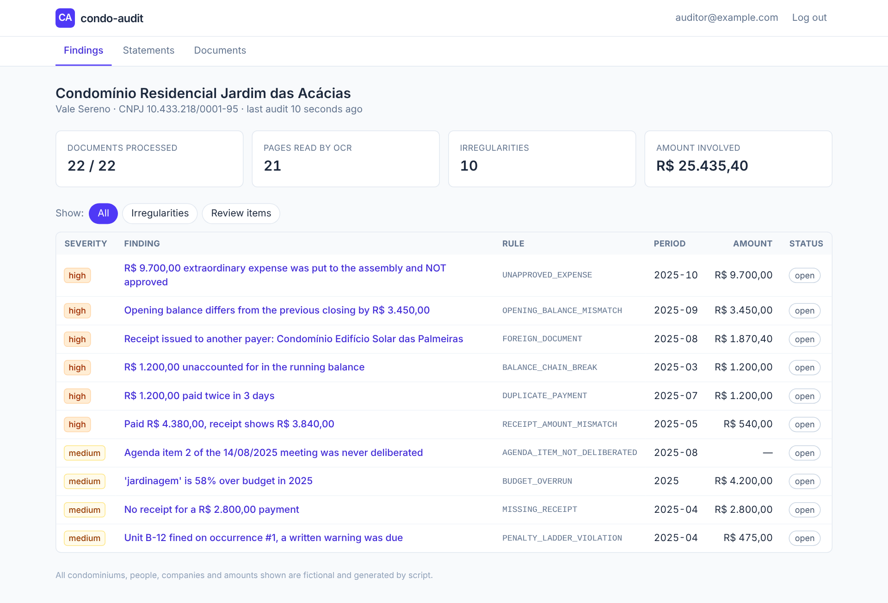
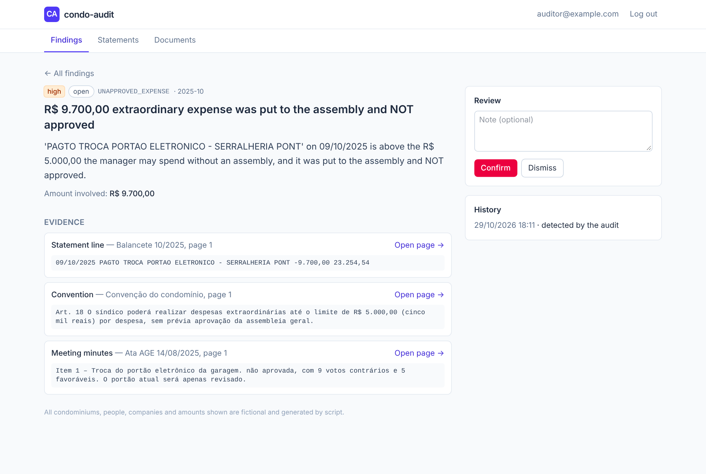
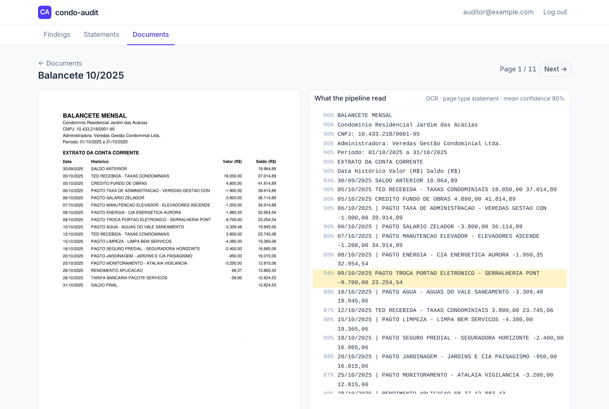
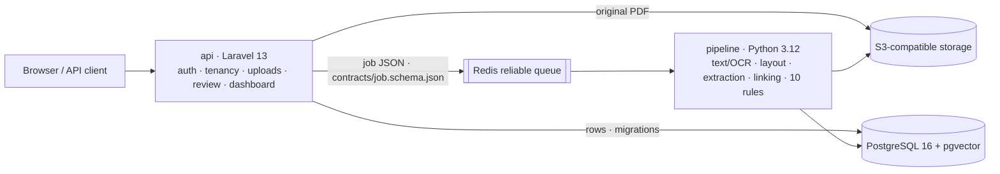

# condo-audit

[](https://github.com/EricsonCBizarro/condo-audit/actions/workflows/ci.yml)


**Audits a condominium's books from the PDFs it already receives.** condo-audit
ingests monthly financial statements, receipts, budgets, meeting notices,
minutes, bylaws and penalty notices (scanned or not), turns them into
structured data, and runs explainable audit rules. Every finding says what is
wrong, how much money is involved and **which page of which document proves it**.



> All condominiums, people, companies and amounts in this repository are
> fictional and generated by a script. See [Synthetic data](#synthetic-data-and-evaluation).

## The problem

In Brazil a residential building is run by an elected manager (*síndico*) and
usually a property-management company. Owners get a monthly statement
(*balancete*) — a bank extract followed by dozens of receipts — plus meeting
minutes and house rules, mostly as PDFs, often scanned. Checking that the
balance adds up, that every payment has a receipt for the right amount and the
right payer, that expenses were approved by the assembly and that penalties
follow the bylaws takes hours per month, so nobody does it.

## Run it (Docker + make)

```bash
git clone https://github.com/EricsonCBizarro/condo-audit.git && cd condo-audit
make demo
```

`make demo` creates a `.env` with random local secrets, builds and starts the
stack, generates two fictional condominiums (40 PDFs, some scanned), ingests
them through the same service the upload API uses, waits for OCR and
extraction, runs the audit and checks the result against the planted ground
truth. Then open <http://localhost:8080> — the login and password are printed
at the end.

```text
rule                            tp  fp  fn precision  recall
AGENDA_ITEM_NOT_DELIBERATED      1   0   0      100%    100%
BALANCE_CHAIN_BREAK              1   0   0      100%    100%
BUDGET_OVERRUN                   1   0   0      100%    100%
DUPLICATE_PAYMENT                1   0   0      100%    100%
FOREIGN_DOCUMENT                 1   0   0      100%    100%
MISSING_RECEIPT                  1   0   0      100%    100%
OPENING_BALANCE_MISMATCH         1   0   0      100%    100%
PENALTY_LADDER_VIOLATION         1   0   0      100%    100%
RECEIPT_AMOUNT_MISMATCH          1   0   0      100%    100%
UNAPPROVED_EXPENSE               1   0   0      100%    100%
TOTAL                           10   0   0      100%    100%
```

Other targets: `make test`, `make lint`, `make eval`, `make report`, `make logs`,
`make down`, `make reset` (`make help` lists them all).

## What it finds

| Rule | Detects | Evidence it cites |
|---|---|---|
| `BALANCE_CHAIN_BREAK` | previous balance + entry ≠ printed balance | the statement line |
| `OPENING_BALANCE_MISMATCH` | a month does not open where the last one closed | both lines |
| `MISSING_RECEIPT` | payment above a threshold with no receipt | the statement line |
| `RECEIPT_AMOUNT_MISMATCH` | receipt amount ≠ amount that left the account | line + receipt |
| `DUPLICATE_PAYMENT` | same payee and amount twice within N days | both lines |
| `BUDGET_OVERRUN` | category spending above the approved budget + tolerance | the budget line |
| `UNAPPROVED_EXPENSE` | expense above the convention's limit without (or against) an assembly decision | line + convention article + minutes item |
| `FOREIGN_DOCUMENT` | receipt issued to another payer (name or tax id) | the receipt |
| `PENALTY_LADDER_VIOLATION` | fine where the bylaws require a written warning first | notice + bylaw clause |
| `AGENDA_ITEM_NOT_DELIBERATED` | item announced in the notice but absent from the minutes | the notice |
| `LOW_CONFIDENCE_EXTRACTION` | a break on a line OCR was unsure about → **review item, not an accusation** | the line |

A sample output is in [`docs/sample-report.md`](docs/sample-report.md).

| Finding with its legal basis | Scanned page next to what OCR read |
|---|---|
|  |  |

## Architecture



- **Two services, one boundary** ([ADR-0001](docs/adr/0001-polyglot-services.md)).
  Laravel owns the product surface and the schema; Python owns everything that
  reads and judges documents (and, next, the AI layer).
- **Explicit job contract** ([ADR-0002](docs/adr/0002-job-contract-and-reliable-queue.md)):
  a versioned JSON Schema validated by *both* test suites, consumed with a
  reliable-queue pattern — per-worker processing lists, exponential backoff,
  dead-letter list, heartbeat-based orphan recovery.
- **Medallion layers**: immutable originals (bronze, SHA-256) → page text and
  lines with OCR confidence (silver) → entities and findings (gold).
  Details in [docs/architecture.md](docs/architecture.md).

## Engineering highlights

- **Evidence-first findings** with stable fingerprints: re-running the audit
  never duplicates a finding nor resets a human review; findings that
  disappear are deactivated, not deleted ([ADR-0006](docs/adr/0006-findings-and-human-review.md)).
- **Idempotent reprocessing** that keeps ids of reviewed rows (upsert by
  natural key) and never overrides a confirmed or rejected receipt link.
- **Data quality ≠ irregularity**: low OCR confidence produces a review item,
  not an accusation ([ADR-0005](docs/adr/0005-ocr-engine.md)).
- **Multi-tenant by construction**: scoped route bindings + policies, tenant
  re-check in the worker, cross-tenant tests ([ADR-0008](docs/adr/0008-multi-tenancy.md)).
- **Money is `numeric`/`Decimal`, never float**, with a Hypothesis round-trip
  test ([ADR-0004](docs/adr/0004-money-as-decimal.md)).
- **Measured, not claimed**: precision/recall against planted ground truth in
  CI ([ADR-0007](docs/adr/0007-synthetic-data-and-evaluation.md)).
- **Observability basics**: correlation id from HTTP to worker logs
  (structured JSON), `pipeline_runs` with attempts/timings/stats, a health
  endpoint that checks every dependency.

## Quality

| | API (PHP) | Pipeline (Python) |
|---|---|---|
| Tests | 35 PHPUnit feature/unit tests | 97 pytest tests (unit, property-based, PostgreSQL/Redis integration, real OCR) |
| Static analysis | PHPStan level 8 (Larastan) | mypy `--strict` |
| Style | Pint | ruff (lint + format) |
| Coverage | — | 91% (branches included), gate at 85% |

CI ([`ci.yml`](.github/workflows/ci.yml)) runs both suites with their own
PostgreSQL and Redis, then an **end-to-end job** that builds the images, runs
the test suites inside the containers, seeds the demo, and fails if audit
precision or recall drops below 90%; plus a gitleaks secret scan.

## Synthetic data and evaluation

`condo-audit synth generate --seed 42` writes, deterministically:

- **Residencial Jardim das Acácias** — 12 monthly statements with receipts,
  budget, convention, bylaws, two meetings (notice + minutes) and penalty
  notices, with **ten irregularities planted on purpose**;
- **Edifício Mirante do Vale** — a clean control group, to measure false
  positives;
- some PDFs rasterized with noise, blur and rotation so the OCR path is
  exercised; and `ground_truth.json` listing every planted problem.

Tax ids are generated with invalid check digits so they can never match a real
company. 100% here is a regression guarantee, not a real-world accuracy claim —
the harness exists to catch regressions and, next, to evaluate the AI agent.

## Repository layout

```
api/            Laravel 13 — API v1, dashboard, schema (migrations), dispatch, review workflow
pipeline/       Python package `condo_audit` — worker, OCR, extraction, rules, synth, eval, report
contracts/      job.schema.json shared by both services
docs/           architecture, ADRs, API reference, glossary, sample report, screenshots
docker/         init scripts (PostgreSQL, SeaweedFS)
Makefile        up · seed · demo · test · lint · eval · report
```

## Roadmap

- [x] Base: services, schema, multi-tenancy, Docker Compose, Makefile
- [x] Synthetic world with planted irregularities and PDFs (native + scanned)
- [x] End-to-end pipeline: ingestion → OCR → extraction → rules → findings → report
- [x] Quality: tests on both sides, static analysis, CI with evaluation gate
- [ ] **AI layer**: pgvector RAG over minutes and bylaws; an auditor agent that
      answers questions and explains findings citing document and page; an MCP
      server to use the audit from Claude or Cursor; answer evaluation reusing
      the ground-truth harness
- [ ] Prebuilt images on GHCR for a faster first run; PostgreSQL row-level security

## Resumo em português

**condo-audit** audita as contas de condomínios a partir dos PDFs que eles já
recebem — balancetes, comprovantes, previsão orçamentária, editais, atas,
convenção, regimento interno e notificações de multa, escaneados ou não.
O sistema extrai os dados (texto nativo ou OCR com Tesseract), concilia o
saldo linha a linha, liga cada pagamento ao seu comprovante e aplica regras de
auditoria explicáveis: quebra de saldo, saldo inicial divergente, pagamento
sem comprovante ou com valor diferente, pagamento em duplicidade, estouro de
orçamento, despesa extraordinária sem aprovação em assembleia, comprovante em
nome de outro pagador, multa sem advertência prévia e pauta não deliberada.
Cada achado mostra o valor envolvido e **a página do documento que o comprova**.

Arquitetura: API e painel em **Laravel 13** (PHP 8.3), processamento de
documentos em **Python 3.12**, **PostgreSQL 16** (com pgvector), **Redis** como
fila confiável com contrato JSON versionado e armazenamento compatível com
**S3**. Para rodar: `make demo`. Todos os dados do repositório são fictícios e
gerados por script, com irregularidades plantadas e um gabarito
(`ground_truth.json`) usado para medir precisão e cobertura da auditoria.

## License

[MIT](LICENSE)
