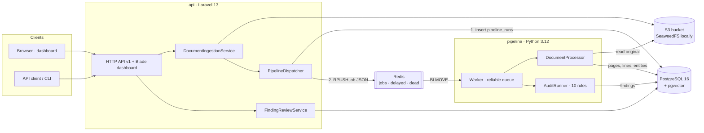
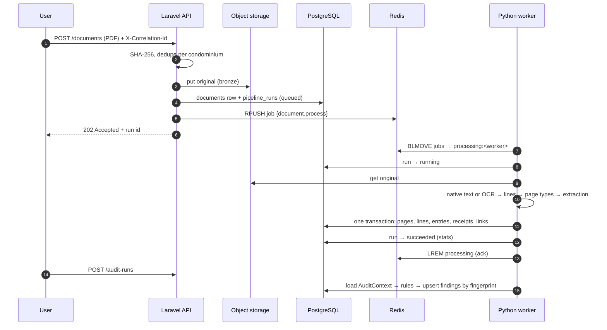

# Architecture

## Services

## One upload, end to end

## Data layers

| Layer | What | Tables / storage | Rule |
|---|---|---|---|
| Bronze | original file, SHA-256, ingestion time | bucket + `documents` | never edited |
| Silver | text per page, lines with bbox and confidence, page type | `document_pages`, `page_lines` | rebuilt on reprocessing |
| Gold | statement entries, receipts, budget, agenda, decisions, clauses, parameters, penalties | domain tables | upserted by natural key |
| Findings | rule results with evidence | `findings`, `finding_events` | upserted by fingerprint; reviews never reset |

## Pipeline stages

1. **Text.** PyMuPDF words for pages with a text layer; otherwise the page is
   rendered at 300 DPI and read by Tesseract (`por`). Both produce positioned
   words with a confidence ([`documents/reader.py`](../pipeline/src/condo_audit/documents/reader.py)).
2. **Layout.** Words → lines. Statement tables are split at the midpoints
   between dates of the left-most date column, which survives uneven row
   spacing and slightly rotated scans ([`layout.py`](../pipeline/src/condo_audit/documents/layout.py)).
3. **Page type.** `statement`, `receipt`, `contract`, `other`, by token
   co-occurrence that tolerates OCR noise ([`pages.py`](../pipeline/src/condo_audit/extraction/pages.py)).
4. **Extraction.** One extractor per document type: statement rows with
   balance reconciliation, receipts, budget lines, agenda items, decisions
   (approved? amount?), bylaw clauses and the penalty ladder, the convention's
   spending limit, penalty notices.
5. **Linking.** Debits ↔ receipts by amount, payee words and date
   ([`linking.py`](../pipeline/src/condo_audit/linking.py)). Suggestions only;
   confirmed or rejected links are never touched.
6. **Audit.** Pure rules over a typed context ([`audit/`](../pipeline/src/condo_audit/audit/)).

## Reliability

- **At-least-once jobs, idempotent handlers.** Reprocessing a document or
  re-running an audit converges to the same rows.
- **Retries with backoff** (`5s · 2^attempt`), **dead-letter list** after
  3 attempts, **orphan recovery** via worker heartbeats.
- **Tenant checks twice:** scoped route bindings + policies in the API; the
  worker refuses a document that does not belong to the job's condominium.
- **Health:** `GET /api/v1/health` checks PostgreSQL, Redis and the bucket.
- **Tracing:** one correlation id per request, logged by both services.

## Decisions

See [`adr/`](adr/) for the reasoning behind each choice and its trade-offs.
