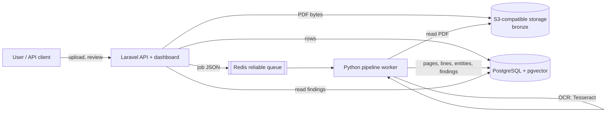
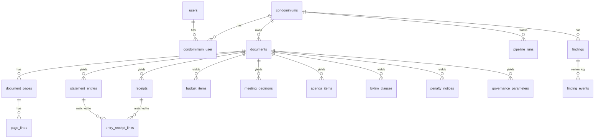

# condo-audit — Portfolio Spec

> Status: phases 1–5 implemented; phase 6 (AI) next. ADRs in `docs/adr/`
> record the individual decisions and their trade-offs.

## 1. Problem

Residential condominiums in Brazil are run by a property manager
(*administradora*) and a building manager (*síndico*). Owners receive monthly
financial statements (*balancetes*), meeting minutes (*atas*), bylaws
(*regimento interno*), a convention (*convenção*) and penalty notices — mostly
as PDFs, many of them scanned. Checking whether the money and the rules add up
is manual, slow and rarely done.

`condo-audit` ingests those documents, turns them into structured data (OCR +
extraction), and runs explainable audit rules that produce **findings**: each
one with a severity, an explanation and **evidence pointing at the exact
document page** it came from.

## 2. Goals and non-goals

Goals
- Multi-condominium (multi-tenant) from day one.
- End-to-end pipeline: ingestion → OCR → extraction → audit rules → report.
- Reproducible demo with **100% synthetic data**, generated by a script, with
  irregularities planted on purpose and a ground-truth file to measure the
  audit's precision and recall.
- Production-minded engineering: containers, reliable queue, idempotency,
  typed code, tests at every layer, CI, documented decisions.
- Ready for an AI layer (RAG with pgvector, auditor agent, MCP server).

Non-goals (for now)
- Accounting system or payment processing.
- Full legal analysis. The tool points at evidence; people decide.
- Production deployment (the stack is deployable, but no cloud IaC yet).

## 3. Architecture



Two services, split by responsibility, not by convenience:

| Service | Language | Owns |
|---|---|---|
| `api/` | PHP 8.3 / Laravel 13 | Product surface: auth (Sanctum), tenancy, uploads, REST API, review workflow, dashboard, **database schema (migrations)**, job dispatch |
| `pipeline/` | Python 3.12 | Document processing: text/OCR, layout, classification, extraction, receipt matching, audit rules engine, reports, synthetic data, evaluation |

They share PostgreSQL and talk through a **versioned JSON job contract**
(`contracts/job.schema.json`) on Redis, validated on both sides by contract
tests. See ADR-0001 and ADR-0002.

### Data layers (medallion)

| Layer | Content | Where |
|---|---|---|
| Bronze | Original file, immutable, SHA-256, ingestion timestamp | object storage + `documents` |
| Silver | Page text, lines with coordinates and OCR confidence, page type | `document_pages`, `page_lines` |
| Gold | Structured entities (statement entries, receipts, budget, decisions, clauses, penalties) and findings | domain tables + `findings` |

Rules of the house: bronze is never edited; silver/gold are **derived and
reproducible** (reprocessing a document replaces its derived rows inside one
transaction); **human decisions are never overwritten** (finding review status
and confirmed links survive reprocessing via stable fingerprints).

## 4. Data model (generic, multi-condominium)



Key tables (every tenant-owned row carries `condominium_id`):

- `condominiums` — name, slug, tax id, settings (`jsonb`: tolerances,
  thresholds, category keywords, penalty ladder).
- `documents` — type (`financial_statement`, `budget`,
  `meeting_minutes`, `meeting_notice`, `bylaws`, `convention`,
  `penalty_notice`, `other`), reference period, storage key, SHA-256 (unique
  per condominium → dedupe), pages, status, `ingested_at`.
- `document_pages` / `page_lines` — text source (`native` | `ocr`), page type,
  line text, bounding box, confidence.
- `statement_entries` — date, description, amount (`numeric(14,2)`, signed),
  running balance, category, reconciliation status, OCR confidence.
- `receipts` — payee, payer name/tax id, amount, date, page.
- `entry_receipt_links` — score, status (`suggested` / `confirmed` /
  `rejected`), origin (`auto` / `manual`).
- `budget_items`, `meeting_decisions` (approved expenses), `agenda_items`,
  `bylaw_clauses`, `governance_parameters` (e.g. spending limit without an
  assembly, with the clause it came from), `penalty_notices`.
- `findings` — rule code, category (`irregularity` | `data_quality`),
  severity, title, explanation, amount, evidence (`jsonb`: document, page,
  excerpt), fingerprint (unique → idempotent), status (`open` / `confirmed` /
  `dismissed`).
- `finding_events` — who changed what and why (review audit trail).
- `pipeline_runs` — job id, type, status, attempts, timings, error, stats.

Money is `numeric(14,2)` in the database and `Decimal` in Python — never float
(ADR-0004).

## 5. Pipeline

1. **Ingest** (Laravel): upload → SHA-256 → dedupe per condominium → store in
   bucket → `documents` row → `document.process` job.
2. **Text** (Python): native text layer via PyMuPDF; pages without text are
   rendered at 300 DPI and OCR'd with Tesseract (`por`). Both paths produce the
   same `PageLayout` (words with boxes and confidence).
3. **Layout**: words → lines with date-anchored row clustering (handles tables
   with uneven spacing).
4. **Classify**: page type (`statement`, `receipt`, `contract`, `billing`,
   `other`) by token co-occurrence, tolerant to OCR noise.
5. **Extract**: one extractor per document/page type → gold tables.
6. **Link**: statement debits ↔ receipts by amount, payee tokens and date
   distance; always a suggestion, a human confirms.
7. **Audit** (`audit.run` job per condominium): rules read a typed
   `AuditContext`, return findings; persisted idempotently.
8. **Report**: dashboard + Markdown/JSON report.

### Audit rules (v1)

| Code | What it detects |
|---|---|
| `BALANCE_CHAIN_BREAK` | previous balance + entry ≠ next balance |
| `OPENING_BALANCE_MISMATCH` | month opening balance ≠ previous month closing |
| `MISSING_RECEIPT` | debit above threshold with no matching receipt |
| `RECEIPT_AMOUNT_MISMATCH` | receipt for the same payee/date with a different amount |
| `DUPLICATE_PAYMENT` | same payee and amount paid twice within N days |
| `BUDGET_OVERRUN` | category spending above the approved budget + tolerance |
| `UNAPPROVED_EXPENSE` | expense above the convention's limit without an approving decision in the minutes |
| `FOREIGN_DOCUMENT` | receipt issued to another condominium (name/tax id) |
| `PENALTY_LADDER_VIOLATION` | fine skipping the bylaws' progressive steps |
| `AGENDA_ITEM_NOT_DELIBERATED` | notice agenda item with no deliberation in the minutes |
| `LOW_CONFIDENCE_EXTRACTION` (data quality) | reconciliation breaks on low-confidence OCR lines → human review instead of a false accusation |

## 6. Synthetic data strategy

- `condo-audit synth generate --seed 42` builds a fictional world
  deterministically: two invented condominiums (one with planted issues, one
  clean control group), a fictional property manager, units, residents,
  12 months of statements with receipts, budget, convention, bylaws, notices,
  minutes and penalty notices.
- PDFs are rendered with ReportLab; some are **rasterized with noise, blur and
  slight rotation** to look scanned and force the OCR path.
- Every planted irregularity is written to `ground_truth.json`.
  `condo-audit eval` compares findings against it and prints precision/recall
  per rule; CI fails if recall drops below the threshold.
- Tax ids are generated with **invalid check digits on purpose**, so they can
  never belong to a real company or person (enforced by a test).
- Generated files live in `data/` (git-ignored); nothing real is ever committed.

## 7. Repository layout

```
condo-audit/
├── api/                    Laravel 13 (API, dashboard, schema, dispatch)
├── pipeline/               Python package `condo_audit` (worker + CLI)
│   ├── src/condo_audit/
│   │   ├── documents/      text, OCR, layout, classification
│   │   ├── extraction/     money, dates, statements, receipts, budget, minutes…
│   │   ├── audit/          engine + rules
│   │   ├── synth/          synthetic world + PDF rendering + ground truth
│   │   ├── evaluation/     precision/recall against ground truth
│   │   └── report/
│   └── tests/
├── contracts/              job.schema.json (shared queue contract)
├── docs/                   architecture, ADRs, glossary, sample report, images
├── docker-compose.yml
├── Makefile                make up / seed / test / demo / lint / eval
└── .github/workflows/      CI
```

## 8. Roadmap

| Phase | Deliverable | Done when | Status |
|---|---|---|---|
| 1. Base | repo, schema, services, compose, Makefile | `make up` brings everything up healthy; `make test` green | done |
| 2. Synthetic data | generator + PDFs + ground truth | deterministic output, tax ids invalid by construction | done |
| 3. End-to-end | ingest → OCR → extract → rules → findings/report | `make seed` produces findings matching ground truth | done (10/10, 0 false positives) |
| 4. Quality | pytest + Hypothesis, PHPUnit, ruff, mypy strict, Pint, PHPStan (Larastan), CI with e2e + eval + gitleaks | CI green | done (pending first run on GitHub) |
| 5. Presentation | README (EN + PT summary), Mermaid diagrams, screenshots, sample report, ADRs | a recruiter gets it in 30 s, runs it in 5 min | done |
| 6. AI (later) | pgvector RAG over minutes/bylaws, auditor agent that explains findings citing sources, MCP server, answer evaluation | eval harness reports groundedness/accuracy | next |

## 9. What else makes this stand out (beyond the base request)

1. **Measured, not claimed**: ground truth + `make eval` with precision/recall
   per rule, also in CI. The same harness later evaluates the AI agent.
2. **Evidence-first findings**: every finding links to document + page +
   excerpt. This is the foundation for citation-grounded RAG.
3. **Reliable queue pattern** (processing list, retries, dead-letter, stuck-job
   reaper) and a **JSON-Schema contract tested on both sides**.
4. **Tenant isolation tests**: cross-tenant access is explicitly tested.
5. **Data-quality vs irregularity split**: low-confidence OCR never becomes an
   accusation — it becomes a review item.
6. **Decimal money**, property-based tests (Hypothesis) for parsers.
7. **ADRs** for every non-obvious decision, with the trade-off spelled out.
8. **Observability basics**: structured JSON logs with a correlation id that
   travels API → queue → worker; health endpoint checking DB, Redis, storage.
9. **Supply-chain hygiene**: gitleaks in CI, pinned images and dependencies,
   `.env.example` only.
10. **Small, conventional commits** that tell the story phase by phase.
